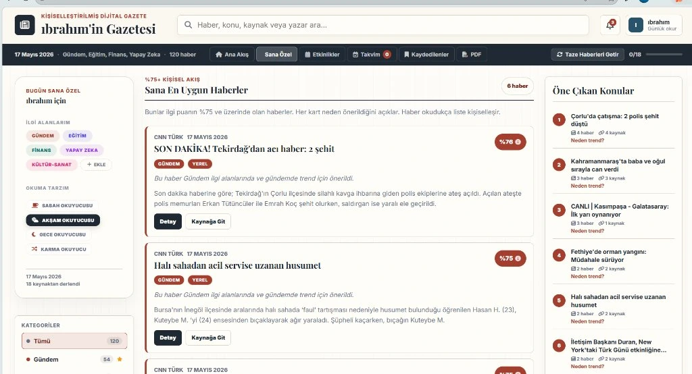

# 🗞️ Kişisel Gazete (Smart Newspaper Engine)

<p align="left">
  
  
  
  
</p>

Full-stack personalized digital newspaper and NLP recommendation system featuring multi-source news crawling, multi-label topic classification, explainable reader feeds, institutional event calendars, and print-ready PDF newspaper layout generation.



---

## 🚀 Core Modules

- **Module 1 — News Data Collection:** Multi-source RSS/web crawlers with citation tracking and URL/content deduplication.
- **Module 2 — NLP Content Classification:** Multi-label category assignment, keyword extraction, and active-learning admin reclassification.
- **Module 3 & 4 — Personal Newspaper & PDF Export:** Dynamic newspaper layout engine with A4/tabloid print preview and PDF generation.
- **Module 5 & 6 — Events, Search & Trending Clusters:** Story clustering across sources, advanced filtering, and calendar event reminders.
- **Module 7 & 8 — Recommender Analytics & RBAC Admin:** Hybrid ranking combining explicit category preferences with reading telemetry.

---

## ⚡ Quick Start

```bash
npm install
npm start
```

---

## 👤 Author

**İbrahim Türkel** — [ibrahimturkel.com.tr](https://ibrahimturkel.com.tr) · [GitHub](https://github.com/turkelibrahim) · [LinkedIn](https://www.linkedin.com/in/ibrahim-t%C3%BCrkel-065283261/)
